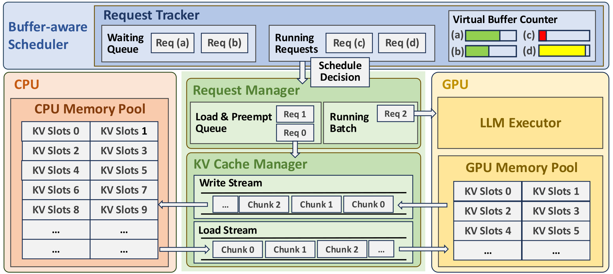
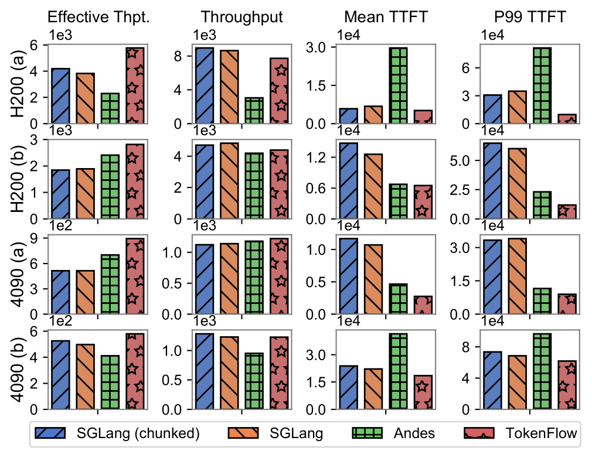
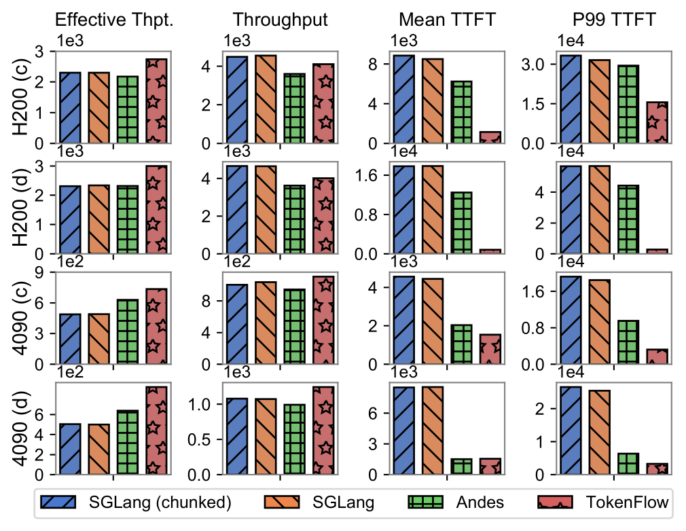
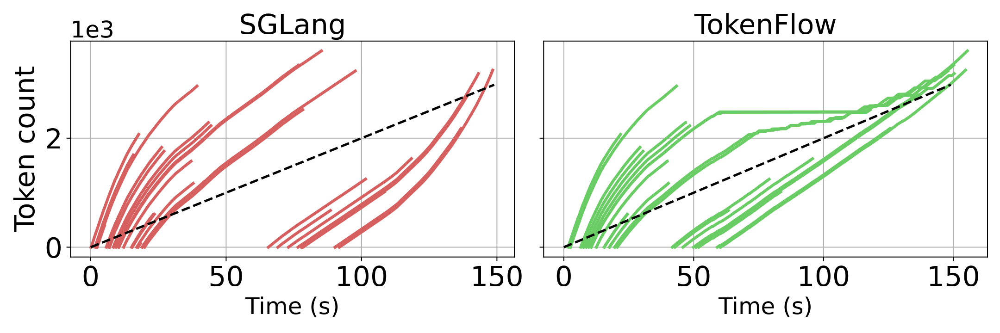

<div align="center">

# TokenFlow: Responsive LLM Text Streaming Serving under Request Burst via Preemptive Scheduling

[](https://arxiv.org/abs/2510.02758)
[](https://doi.org/10.1145/3767295.3769328)
[](https://2026.eurosys.org/)
[](LICENSE)

**Junyi Chen, Chuheng Du, Renyuan Liu, Shuochao Yao, Dingtian Yan,<br>
Jiang Liao, Shengzhong Liu, Fan Wu, and Guihai Chen**

Accepted by **EuroSys 2026**

[Paper](https://arxiv.org/abs/2510.02758) · [Quick Start](#quick-start) · [Reproduction](#reproducing-the-paper-results) · [Citation](#citation)

</div>

## Overview

Interactive LLM applications need both a short **time to first token (TTFT)** and a smooth, application-specific output rate. Under bursty traffic, conventional FCFS and prefill-prioritized serving creates a mismatch: some requests wait for seconds before their first token while already-running requests generate tokens much faster than users can consume them.

TokenFlow turns the surplus tokens in each client's streaming buffer into a scheduling opportunity. It jointly combines:

- **Buffer-aware preemptive scheduling** that prioritizes requests using their current token-buffer occupancy, target consumption rate, waiting time, and memory cost.
- **Proactive hierarchical KV-cache management** that moves KV cache between GPU and CPU memory before memory pressure becomes critical.
- **Write-through and load-evict overlap** that hides most GPU-CPU transfer cost behind model execution.
- **Streaming-aware QoS accounting** that rewards useful, on-time tokens while penalizing TTFT and playback stalls.

The implementation is built on [SGLang](https://github.com/sgl-project/sglang) and exposes TokenFlow through the `paper_v1` KV-offload scheduling policy.

<p align="center">
  
</p>

The request tracker continuously estimates each request's virtual output buffer. Requests with enough buffered tokens can be paused without causing a visible stall; their KV state is proactively written to CPU memory, allowing urgent or newly arrived requests to run earlier. When a paused request's buffer approaches depletion, TokenFlow restores its KV state and resumes generation.

## Key Results

Across Llama3 and Qwen2.5-family models on NVIDIA RTX 4090, A6000, and H200 GPUs, TokenFlow achieves:

- Up to **82.5% higher effective throughput**, counting tokens according to when users can actually consume them.
- Up to **80.2% lower P99 TTFT** without degrading raw token throughput.
- On real-world traces, **52.6% lower mean TTFT on average**, with effective-throughput gains of **45.1% on A6000** and **37.1% on H200**.
- Only about **0.4 ms scheduling overhead**, compared with approximately 0.07 ms for SGLang's scheduler.

<table>
  <tr>
    <td width="50%" align="center"><br><sub><b>Burst arrivals.</b> TokenFlow improves effective throughput and sharply reduces mean and P99 TTFT.</sub></td>
    <td width="50%" align="center"><br><sub><b>Poisson arrivals.</b> TokenFlow remains effective under sustained stochastic load.</sub></td>
  </tr>
</table>

<p align="center">
  
  <br>
  <sub>TokenFlow starts requests earlier, then deliberately preempts requests whose client buffers already contain enough tokens. The dashed line is the required output rate.</sub>
</p>

## Repository Layout

| Path | Description |
| --- | --- |
| `python/sglang/srt/managers/schedule_policy.py` | Buffer-aware request ranking and the `paper_v1` scheduling objective. |
| `python/sglang/srt/managers/scheduler.py` | Request-buffer tracking, periodic rescheduling, preemption, and resumption. |
| `python/sglang/srt/mem_cache/sync_cache.py` | Incremental write-through synchronization and request-level KV eviction. |
| `python/sglang/srt/managers/cache_controller.py` | Asynchronous KV load/write queues and I/O workload feedback. |
| `kvoffload/scripts/` | Server and benchmark launchers. |
| `kvoffload/bench_analysis.py` | JSONL-to-CSV metric summarization and token-timeline plots. |
| `kvoffload/plot_ttft_cdf.py` | TTFT CDF comparison. |
| `kvoffload/plot_service_metrics_timeline.py` | Waiting-request and effective-throughput timelines. |

For an implementation-oriented description of every modified component, see [`kvoffload/technical_report.md`](kvoffload/technical_report.md).

## Installation

### Requirements

- Linux and Python 3.10 or newer.
- An NVIDIA CUDA GPU for the main implementation. The paper evaluates RTX 4090, A6000, and H200 GPUs; Section 7.4 additionally reports Ascend 910B results.
- Enough host memory for the hierarchical KV cache. `--hicache-size` is expressed in GiB; reduce it from the examples below if necessary.
- A local or Hugging Face model compatible with SGLang. Gated models such as Llama 3 require the corresponding Hugging Face access.

### Install from source

```bash
git clone https://github.com/SJTU-RTEAS/TokenFlow.git
cd TokenFlow

python3 -m venv .venv
source .venv/bin/activate
python -m pip install --upgrade pip setuptools wheel
python -m pip install -e "python[all]"
python -m pip install matplotlib pandas
```

The repository pins the Python and CUDA-side dependencies used by this branch in `python/pyproject.toml`. For container deployment and pinned-memory troubleshooting, see [`kvoffload/docker_run_guide.md`](kvoffload/docker_run_guide.md).

## Quick Start

### 1. Launch a TokenFlow server

Set `TOKENFLOW_MODEL` to a Hugging Face model ID or a local model directory. The example below uses one of the model families evaluated in the paper. Adjust `--tp-size`, `--mem-fraction-static`, and `--hicache-size` for your hardware.

```bash
export TOKENFLOW_MODEL=meta-llama/Meta-Llama-3-8B-Instruct

sglang serve \
  --model-path "$TOKENFLOW_MODEL" \
  --host 0.0.0.0 \
  --port 30000 \
  --tp-size 1 \
  --mem-fraction-static 0.3 \
  --max-running-requests 128 \
  --enable-hierarchical-cache \
  --hicache-size 40 \
  --kv-offload-policy paper_v1 \
  --kv-offload-default-output-speed 20
```

The essential switches are `--enable-hierarchical-cache` and `--kv-offload-policy paper_v1`. TokenFlow's policy is not compatible with prefill/decode disaggregation; keep `--disaggregation-mode null` when it is enabled.

### 2. Send a streaming request

`output_speed` is TokenFlow's per-request target consumption rate in tokens per second. If omitted, the server uses `--kv-offload-default-output-speed`.

```bash
export TOKENFLOW_MODEL=meta-llama/Meta-Llama-3-8B-Instruct

curl http://127.0.0.1:30000/v1/chat/completions \
  -H 'Content-Type: application/json' \
  -d "{
    \"model\": \"$TOKENFLOW_MODEL\",
    \"messages\": [{\"role\": \"user\", \"content\": \"Explain why request bursts hurt LLM streaming.\"}],
    \"max_tokens\": 256,
    \"temperature\": 0.7,
    \"stream\": true,
    \"output_speed\": 20
  }"
```

### 3. Run a smoke benchmark

The bundled launcher wraps `python -m sglang.bench_serving`. Keep `MODEL` identical to the model served above.

```bash
export TOKENFLOW_MODEL=meta-llama/Meta-Llama-3-8B-Instruct

MODEL="$TOKENFLOW_MODEL" \
NUM_PROMPTS=32 \
REQUEST_RATE=inf \
MAX_CONCURRENCY=32 \
RANDOM_INPUT_LEN=512 \
RANDOM_OUTPUT_LEN=1024 \
OUTPUT_SPEED=20 \
TAG=smoke-tokenflow \
bash kvoffload/scripts/bench_serving.sh
```

## Reproducing the Paper Results

### Evaluation protocol

The controlled experiments compare four schedulers: SGLang with chunked prefill, SGLang, Andes, and TokenFlow. To make a fair comparison, keep the model, GPU allocation, prompt/output distribution, memory fraction, random seed, and request sequence unchanged, and change only the scheduling configuration.

The paper uses the following controlled workload matrix. `inf` sends the complete burst at time zero; a finite request rate generates Poisson arrival times.

| GPU | Scenario | Requests / rate | Mean input | Mean output |
| --- | --- | ---: | ---: | ---: |
| RTX 4090 | Burst, short | 60 requests at once | 512 | 1,024 |
| RTX 4090 | Burst, long | 80 requests at once | 1,024 | 2,048 |
| H200 | Burst, short | 400 requests at once | 512 | 2,048 |
| H200 | Burst, long | 200 requests at once | 1,024 | 4,096 |
| RTX 4090 | Poisson, short | 2 or 4 requests/s | 512 | 1,024 |
| H200 | Poisson, short | 5 or 10 requests/s | 512 | 2,048 |

Input and output lengths are sampled with a 0.2 range ratio. The paper starts the controlled H200 experiments with `--mem-fraction-static 0.3` and reports target output-rate experiments at 20, 25, and 30 tokens/s.

### TokenFlow versus SGLang

Launch TokenFlow as shown in [Quick Start](#quick-start). For the SGLang baseline, restart the same model with the same common server arguments but omit hierarchical caching and `--kv-offload-policy paper_v1`:

```bash
export TOKENFLOW_MODEL=meta-llama/Meta-Llama-3-8B-Instruct

sglang serve \
  --model-path "$TOKENFLOW_MODEL" \
  --host 0.0.0.0 \
  --port 30000 \
  --tp-size 1 \
  --mem-fraction-static 0.3 \
  --max-running-requests 128
```

For the chunked-prefill baseline, additionally set the same fixed `--chunked-prefill-size` for all repeated runs. Andes is described as a separately implemented baseline in the paper and is not exposed as a selectable policy in this repository.

### Example: RTX 4090 short burst

Run the identical benchmark once against each server, changing only `TAG`. The output file is JSONL, so multiple experiments can be appended and analyzed together.

```bash
mkdir -p kvoffload/results

export TOKENFLOW_MODEL=meta-llama/Meta-Llama-3-8B-Instruct

MODEL="$TOKENFLOW_MODEL" \
NUM_PROMPTS=60 \
REQUEST_RATE=inf \
MAX_CONCURRENCY=60 \
RANDOM_INPUT_LEN=512 \
RANDOM_OUTPUT_LEN=1024 \
RANDOM_RANGE_RATIO=0.2 \
OUTPUT_SPEED=20 \
OUTPUT_FILE=kvoffload/results/controlled.jsonl \
REQUEST_OUTPUTS_FILE=kvoffload/results/burst-4090-tokenflow-requests.jsonl \
TAG=burst-4090-short-tokenflow \
bash kvoffload/scripts/bench_serving.sh
```

For a Poisson experiment, keep the lengths fixed and change `REQUEST_RATE` to the paper's rate (for example, `2` or `4` on RTX 4090). Use a sufficiently large `NUM_PROMPTS` for a stable measurement and keep it identical across schedulers.

### Analyze the runs

```bash
python kvoffload/bench_analysis.py \
  --jsonl-path kvoffload/results/controlled.jsonl \
  --metrics-csv kvoffload/results/metrics.csv \
  --plot-dir kvoffload/results/timelines

python kvoffload/plot_ttft_cdf.py \
  --jsonl-path kvoffload/results/controlled.jsonl \
  --tags burst-4090-short-sglang burst-4090-short-tokenflow \
  --out-path kvoffload/results/ttft-cdf.png

python kvoffload/plot_service_metrics_timeline.py \
  --jsonl-path kvoffload/results/controlled.jsonl \
  --tags burst-4090-short-sglang burst-4090-short-tokenflow \
  --num-steps 200 \
  --consume-speed 20 \
  --out-dir kvoffload/results/service-timeline \
  --dump-json
```

The paper's **effective throughput** fully counts tokens generated while the client buffer is below 10% of the response length, linearly decays their contribution between 10% and 20%, and excludes tokens beyond 20%. Report raw throughput alongside effective throughput, mean TTFT, and P99 TTFT.

## Citation

If TokenFlow is useful in your research, please cite:

```bibtex
@inproceedings{chen2026tokenflow,
  author    = {Chen, Junyi and Du, Chuheng and Liu, Renyuan and Yao, Shuochao and Yan, Dingtian and Liao, Jiang and Liu, Shengzhong and Wu, Fan and Chen, Guihai},
  title     = {TokenFlow: Responsive LLM Text Streaming Serving under Request Burst via Preemptive Scheduling},
  year      = {2026},
  isbn      = {9798400722127},
  publisher = {Association for Computing Machinery},
  address   = {New York, NY, USA},
  url       = {https://doi.org/10.1145/3767295.3769328},
  doi       = {10.1145/3767295.3769328},
  booktitle = {Proceedings of the 21st European Conference on Computer Systems},
  pages     = {497--513},
  numpages  = {17},
  keywords  = {LLM serving, text streaming, KV cache management, scheduling optimization},
  location  = {McEwan Hall/The University of Edinburgh, Edinburgh, Scotland UK},
  series    = {EUROSYS '26}
}
```

## Acknowledgments

TokenFlow is implemented on top of [SGLang](https://github.com/sgl-project/sglang). We thank the SGLang contributors and the authors of the systems evaluated in the paper.

## License

This repository is released under the [Apache License 2.0](LICENSE).
